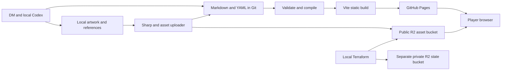

# System architecture

## Goal and decisions

Build a public, illustrated campaign archive whose source remains understandable without the application. This is a proposed architecture, not an implementation.

**Confirmed:** React, TypeScript, Vite, React Router `HashRouter`, GitHub Pages, public GitHub source, Markdown with metadata, Cloudflare R2 assets, Terraform with R2 state, GitHub Actions, and Sharp by default. No application server, database, authentication, CMS, MCP server, or publication permission system.

**Current preview:** One repository with Markdown accounts and entries plus TypeScript types and fictional demo material. Accounts present shared events chronologically; multiple accounts do not duplicate or override event canon. The preview is local and does not imply a completed build compiler, asset pipeline, or deployment.

**Recommended full architecture:** One campaign, a build-time content compiler, and a static reader. Author each event separately. Sessions collect events; accounts present events; entities and documents provide alternate ways into the same history. Illustration IDs resolve through one manifest/resolver, never through hard-coded storage URLs in narrative content.



## Recommended component boundaries

| Component | Responsibility | Must not do |
|---|---|---|
| Content compiler | Parse YAML/Markdown, validate schemas and IDs, resolve links, derive backlinks, emit JSON/search data | Infer campaign facts or modify source during build |
| React reader | Routing, page layouts, search, responsive images, accessible navigation | Carry provider credentials or parse all campaign Markdown on startup |
| Asset resolver | Map image IDs and variant choices to local or public URLs | Embed storage rules in individual components |
| Local artwork tools | Preserve originals, prepare variants, record hashes, upload missing objects | Generate images during ordinary build or delete remote objects |
| Publication workflow | Verify assets, build exact source revision, deploy Pages artifact | Deploy before asset verification succeeds |
| Terraform | Manage storage configuration and delivery settings | Track thousands of individual artwork objects as resources |

## Proposed repository shape

```text
content/
  accounts/ entries/                     # Markdown account presentations and linked entries
  sessions/ events/ entities/ documents/   # Markdown with front matter
  illustrations/                         # per-image YAML manifests
art/
  style-guide.md                         # canonical direction, initially specified in 06
  prompts/                               # versioned prompt text and reference snapshots
src/
  components/ pages/ content/ assets/
tools/
  content/ assets/ publish/
infra/
  main.tf backend.tf backend.hcl.example
docs/specs/
.github/workflows/
.local/art/                              # ignored originals and candidates
.local/assets/                           # ignored prepared derivatives
.generated/                              # ignored compiler output
```

These paths describe the proposed full project shape; `content/accounts/` and `content/entries/` are the scoped local preview sources. Ignore local artwork, generated files, secrets, Terraform plans/state, and dependencies when implementing. Keep the dependency lockfile and Terraform provider lockfile in Git.

## Content compilation and delivery

Recommended pipeline:

1. Parse all supported source records using one shared schema definition. Reject unknown metadata keys to catch typos.
2. Resolve `record:<id>` and `asset:<id>` Markdown destinations and typed metadata references. Reject unsafe URL protocols and raw HTML; do not support MDX or executable content.
3. Derive session/event order, backlinks, entity filters, searchable text, and image usage. Claim labels remain attached to search snippets and detail views.
4. Emit an index of titles/types/order and a content-addressed JSON file per record. Store file mappings in a build-specific index, so cached data cannot be mixed across releases. Emit a separate search index loaded only when search is opened.
5. Build reader code and generated data into one Pages artifact. Browser fetches only the index and current record initially; artwork is requested from R2 at suitable widths.

Use a mature YAML parser, schema validator (recommend Zod), and Markdown AST tooling (recommend remark/unified) after checking compatible versions during implementation. Begin search with normalized text matching, token AND matching, title/alias weighting, and excerpts. Upgrade to a maintained full-text index library only if measured latency/ranking needs it. No embeddings or search service in MVP.

The development server reruns compilation on content changes and displays source diagnostics. Local image overrides are supplied only in development, via a Vite middleware limited to `.local/art/` and `.local/assets/`; prevent path traversal. Production builds exclude this middleware, studio route, and candidate inventory. This is tooling in the existing dev server, not a deployed backend.

## Routing and configuration

Hash routes use stable IDs: `#/events/evt-example`, `#/entities/ent-example`, and the remaining routes in [05](05-frontend-ux.md). Renaming a title must not break a link.

For a repository site, configure Vite `base` as `/<repository>/`; use `/` for a root/custom-domain site. Resolve bundled assets and generated JSON through `import.meta.env.BASE_URL`. Keep the router paths themselves free of the repository prefix. HashRouter puts application location in the fragment, which is not sent to the server. [React Router HashRouter](https://reactrouter.com/api/declarative-routers/HashRouter), [Vite deployment guidance](https://vite.dev/guide/static-deploy.html#github-pages).

Recommended public settings: campaign title, site base path, `VITE_ASSET_BASE_URL`. Account IDs/bucket names belong to publishing/infra configuration, not UI components. Every `VITE_` variable is considered public. The browser never receives Cloudflare, GitHub, Terraform, or OpenAI credentials.

## Tradeoffs and phases

MVP favors portable files and rebuilds over real-time editing. A static SPA has limited per-entry social previews/search-engine indexing because hash fragments share one HTML response; that is acceptable for a small player audience. Build-time validation catches structural mistakes but cannot determine whether a narrative is true.

The design preview establishes the comic-panel Chronicle and account presentations. Later additions may include a development gallery, a better search index, and a separate uncertain in-world timeline. They must consume shared event records. Multi-campaign tenancy, live collaboration, and APIs are not prerequisites.

## Dependencies and acceptance

Depends on [data model](03-data-model.md), [authoring](04-content-authoring.md), [assets](07-asset-management.md), and [publishing](09-ci-cd.md).

Acceptance: one fictional session with two events, one entity, one document, and an illustration renders from source; chronology and backlinks are generated; a project-subpath deep link reloads successfully; changing the asset origin requires configuration only; a credential-free production build contains neither local paths nor candidate artwork.
