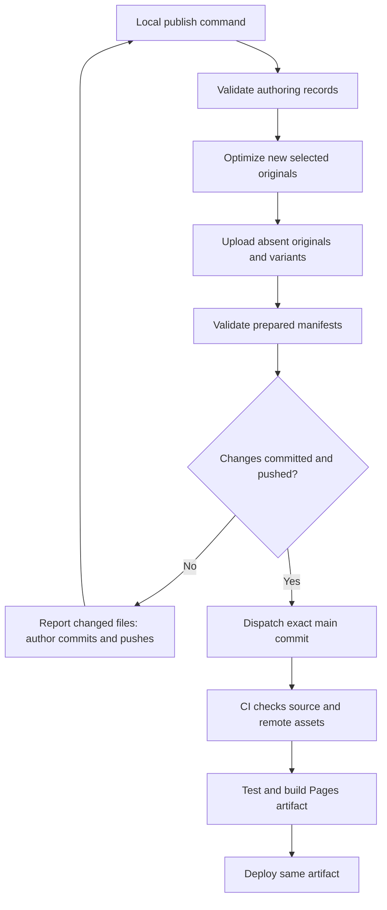

# CI/CD and publishing

## Goal and decisions

Publish a reproducible source revision whose referenced artwork already exists, with an easy local entry point and useful failure messages.

**Confirmed:** GitHub Actions builds/deploys GitHub Pages. Validate content, optimize artwork, upload missing/changed assets, build, then deploy. Repeated runs are safe; uploads must succeed before website deployment; no automatic remote asset deletion or browser credentials.

**Recommended:** Separate local asset preparation from a credential-minimal CI verification/build/deploy run. The single command entry point is `npm run publish`. All commands below are proposed interfaces; none exist yet.

## Solving the local-artwork handoff

Artwork binaries are excluded from Git, so a fresh GitHub runner cannot optimize a new local original. The proposed workflow makes the transfer explicit:

The first run with new art may stop after successful preparation/upload because the manifests changed. The author reviews the content and manifests, commits/pushes using normal Git, and reruns the command. It never auto-commits unrelated work. From clean pushed `main`, a content-only release is one command. This is a Git consistency boundary, not a separate editorial approval system or staged bucket. Uploaded-but-unreferenced objects are harmless and remain public.

**Open review choice:** If literal one-invocation publication with new images is more important than an explicit Git boundary, a later `--commit` mode can commit an explicitly selected file list. Do not make automatic commits the default without deciding that behavior.

## Local command contract

1. Check toolchain and content in authoring mode; do not require local originals for already prepared images.
2. Prepare only images with a selected local input that needs processing, then validate all selected manifests in publish mode.
3. Upload missing originals/variants using the immutable-key protocol in [07](07-asset-management.md). Missing remote objects with no local source fail with the asset ID and recovery instruction. Never quietly remove the reference.
4. Confirm referenced objects are readable from the production asset origin. Retry transient errors with a bounded policy; fail on persistent errors.
5. If source/manifest changes exist, report them and stop before dispatch. Once the author commits/pushes, require a clean tree on `main`, with local HEAD equal to fetched `origin/main`.
6. Dispatch the publication workflow on `main`, supplying the expected full commit SHA. Wait for and report the run URL and result. GitHub Actions checks the resolved workflow commit against the supplied SHA before checking out that exact commit. If `main` moved, fail and ask for a fresh invocation.

No local Terraform apply or image generation is hidden inside publishing. Source changes during preparation require validation again before proceeding. Use an explicit `npm run assets:prepare` when only preparing candidates for review.

## Recommended workflow jobs

| Trigger/job | Responsibilities | Credentials |
|---|---|---|
| Pull request / validate | Locked dependency install, schema/reference validation, typecheck, tests, build, asset-manifest format checks | Read-only GitHub contents; no external secrets |
| `workflow_dispatch` / verify-build | Check exact SHA, repeat validation/tests, verify all selected originals/variants through R2 S3 metadata and public variants through production origin, build static artifact | Asset bucket read-only credential; no state or infrastructure token |
| Deploy (`needs: verify-build`) | Download/upload the built Pages artifact as appropriate and deploy it | `pages: write`, `id-token: write`; `github-pages` environment |

Use GitHub's maintained Pages configure/upload/deploy actions, selecting currently supported versions and pinning full commit SHAs during implementation. Deployment requires appropriate Pages/OIDC permissions, an environment, and a successful build dependency. [GitHub Pages custom workflows](https://docs.github.com/en/pages/getting-started-with-github-pages/using-custom-workflows-with-github-pages).

For MVP, pushes run validation; only the publish dispatch deploys. Use a shared publication concurrency group with `cancel-in-progress: false`. Immediately before deploy, confirm the requested commit remains current `main`; reject stale queued runs. This avoids an older build replacing a newer release. Record the deployed SHA in the artifact and workflow summary. Terraform uses a separate operational process/concurrency boundary.

Pull requests, especially forks, never receive upload/state credentials. Do not use `pull_request_target` to execute untrusted changed code with secrets. Downloaded dependency code runs in the same trust boundary as the build; keep dependencies minimal and locks reviewed.

## Environment and credential inventory

| Variable / credential | Where | Scope / exposure |
|---|---|---|
| `VITE_ASSET_BASE_URL` | Local and Actions variables | Public HTTPS image origin, deliberately bundled |
| `SITE_BASE_PATH` | Build config input | Public `/<repository>/` or `/`, mapped into Vite base |
| `R2_ACCOUNT_ID`, `R2_ASSET_BUCKET`, `R2_ENDPOINT` | Local uploader / CI variables | Non-secret configuration, not needed in browser |
| `R2_ACCESS_KEY_ID`, `R2_SECRET_ACCESS_KEY` | Local credential environment | Object Read & Write, scoped only to asset bucket |
| `R2_ACCESS_KEY_ID`, `R2_SECRET_ACCESS_KEY` | Actions secrets with different values | Object Read only, scoped only to asset bucket |
| GitHub CLI login | Local dispatch | Permission to dispatch Actions in this repository; no token committed |
| `GITHUB_TOKEN` and OIDC | Actions | Job-scoped permissions for Pages; no personal token needed for deploy |
| `CLOUDFLARE_API_TOKEN` | Terraform process only | Account/zone configuration permissions required by selected resources |
| `AWS_ACCESS_KEY_ID`, `AWS_SECRET_ACCESS_KEY` | Terraform process only | Separate state-bucket credential, never asset uploader identity |
| `OPENAI_API_KEY` | Optional explicitly chosen API artwork session only | Not required for native subscription generation, CI, or website |

R2 distinguishes object read/write and read-only credentials with bucket scope. Native GitHub-to-R2 credential federation is not assumed here; start with narrow stored credentials and rotate/revoke on exposure. [R2 authentication](https://developers.cloudflare.com/r2/api/tokens/).

Local tooling loads credentials without logging them. Never use `VITE_` for secrets. Do not place Terraform plan/state artifacts in public workflow logs/artifacts. Initial infrastructure operations remain local; publication CI has no infrastructure permissions.

## Failures, recovery, and tradeoffs

- Validation failure: fix source; no deployment occurs.
- Partial upload: leave already uploaded immutable objects in place; retry skips them.
- Remote integrity/readability failure: block build/deploy, restore missing bytes from backup or local originals.
- Build/deploy failure: retain prior successful site; rerun verification and deploy the same source revision if still current.
- Bad content release: revert the content commit on `main` and publish. Old asset keys remain available. No infrastructure rollback is needed for content.

CI verifies rather than re-optimizes committed image metadata; this avoids processor-dependent hashes changing during deployment. A future recovery tool may fetch originals from R2 and regenerate variants, but its output must be reviewed and committed if hashes change. CI never generates paid artwork.

## Scope, dependencies, and acceptance

MVP includes one deployment workflow, local publish entry point, immutable uploads, exact-SHA verification, asset checks, and rollback by source revert. Later: optional explicit commit mode and richer release summaries. No separate preview service or publication approval hierarchy.

Dependencies: [assets](07-asset-management.md), [infrastructure](08-infrastructure.md), [quality](10-testing-quality.md), [development](12-development-workflow.md). Acceptance: failed upload blocks publication; clean repeated publish makes no asset writes; a fresh runner builds without local originals; fork PRs validate without secrets; moved `main` fails safely; rollback restores prior content with valid images.
